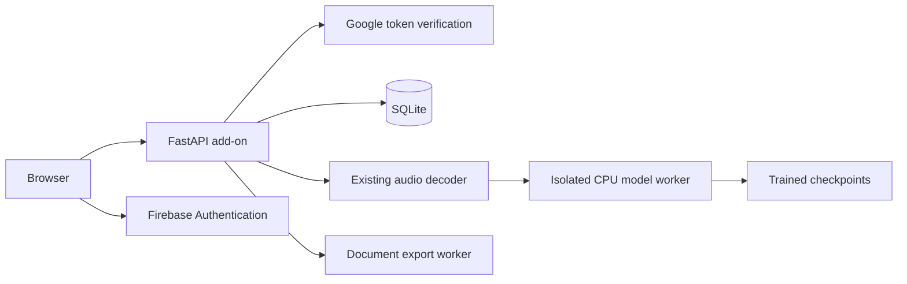

# VoiceGuard architecture

## Active local entry point

`backend_with_pella_nii.py` launches `voiceguard_addon.app:app`. The add-on serves
a dedicated public homepage, the extended original dashboard, and supporting
pages. `presentation.py` and `ui.py` modify served responses rather than moving
the original HTML/CSS/JavaScript files.

## Isolation

Model imports are deferred. A separate process loads a selected detector,
performs inference, and exits. Requests are serialized to limit RAM use.
Temporary waveform arrays are deleted after each worker request. The worker
timeout is 240 seconds.

`legacy.py` provides lightweight health/static routes and lazy legacy inference.
The original `backend.py` remains a separate original launcher.

Checkpoint provenance is documented in `voiceguard_addon/RECOVERY_REPORT.md`.
The public ProSDD release is not the missing private epoch-4 fine-tune.
